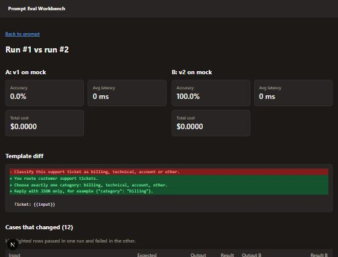

# Prompt Eval Workbench

A small internal tool for testing prompts the way you test code. Save a prompt, attach test cases, run any
version against different Claude models, and compare two runs side by side on accuracy, latency and cost.



## What it does

* **Prompts and versions.** Every edit is saved as a new numbered version, so old runs always point at the
  exact text they used.
* **Test cases** with four match types: `exact`, `contains`, `regex` and `json_field` (reads a field out of
  JSON the model returns, even when it is wrapped in prose or code fences).
* **Runs** execute one version against every test case with limited concurrency. Each result stores the output,
  latency, token counts, cost and any error. One failed API call fails one case, not the whole run.
* **Compare view** shows both runs' metrics, a line diff of the two templates, and highlights every case whose
  result flipped.
* **Mock model** so the app, the tests and CI all work without an API key.

## Stack

TypeScript, Next.js 15 (App Router, typed API routes), React 19, PostgreSQL, the Anthropic SDK, Vitest,
ESLint, Docker and GitHub Actions. Local development uses PGlite (PostgreSQL compiled to WebAssembly), so
no database server is needed.

## Run it

```bash
npm install
npm run dev
```

Open http://localhost:3000 and click **Load example prompt**. The example is a support ticket classifier with
two versions and 12 labeled tickets. Run v1 and v2 with the `mock` model, then open the comparison.

To use real models, set an API key before starting:

```bash
export ANTHROPIC_API_KEY=your_key
npm run dev
```

With PostgreSQL and Docker:

```bash
docker compose up --build
```

## Checks

```bash
npm run lint
npm run typecheck
npm test
npm run build
```

The tests run against an in memory PostgreSQL (PGlite), so they cover the real schema and SQL, not mocks.
GitHub Actions runs all four checks and builds the Docker image on every pull request.

## Project layout

```
db/schema.sql            tables for prompts, versions, test cases, runs and results
src/lib/scoring.ts       match types, JSON extraction, run metrics
src/lib/runner.ts        runs a version against all cases with limited concurrency
src/lib/providers.ts     Claude through the Anthropic SDK, plus a deterministic mock
src/lib/repo.ts          all SQL in one place, typed results
src/lib/diff.ts          line diff for prompt templates
src/app/api/...          typed API routes
src/components/...       reusable React components: results table, prompt diff, metric cards
docs/design-spec.md      the problem, data model and design tradeoffs
```

## Design notes

See [docs/design-spec.md](docs/design-spec.md) for the data model, scoring rules and the tradeoffs behind them.
